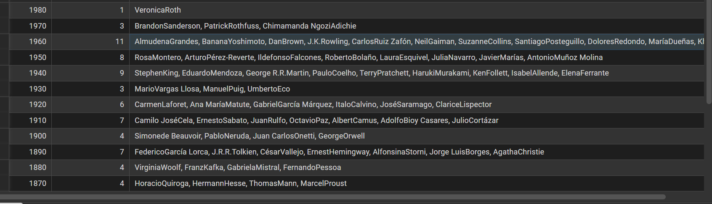
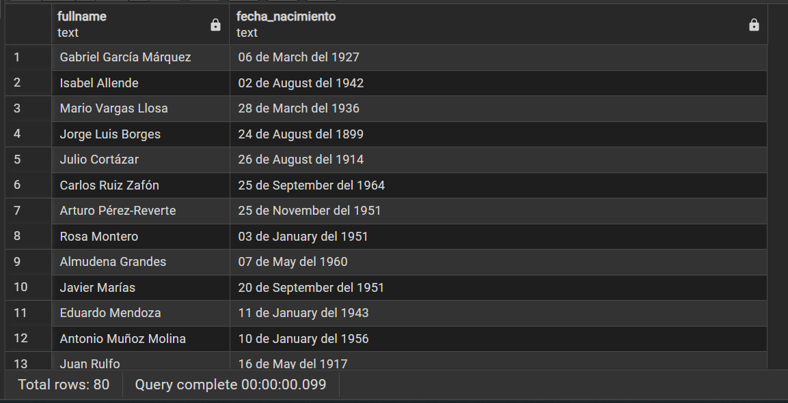

# Imágenes, documentos y fechas con SQL y bases de datos.

## Obtener la fecha y hora actual con SQL.

### Obtenemos la fecha actual
```sql
SELECT CURRENT_DATE AS fecha_actual;
```
> Solo obtenemos la fecha con el formato `YYYY-MM-DD`

### Obtenemos la hora junto a la zona horaria:
```sql
SELECT CURRENT_TIME AS zona_horaria;
```
> Ejemplo de respuesta: `12:19:20.738004-06:00`

> Obtenemos la hora y la zona horaria con el formato `HH:MM:SS.TIMESTAMP`

### Obtener la fecha, la hora y la zona horaria actua:
```sql
SELECT CURRENT_TIMESTAMP AS fecha_hora_zona;
```
> Ejemplo de respuesta: `2026-09-14 12:22:50.185753-06`

> Obtenemos la fecha, la hora junto con la zona horaria con el formato `YYYY-MM-DD HH:MM:SS.TIMESTAMP`

## Obtenemos la hora actual sin la zona horaria
```sql
SELECT LOCALTIME AS hora_actual;
```
> Ejemplo de respuesta: `12:25:00.376887`

> Obtenemos la hora con el formato: `HH:MM:SS.miliseconds`

### Obtenemos la fecha y hora actual sin la zona horaria
```sql
SELECT LOCALTIMESTAMP AS fecha_hora_actual;
```
> Ejemplo de respuesta: `2026-09-14 12:27:03.485776`

> Obtenemos la fecha y hora actual con el formato: `YYYY-MM-DD HH:MM:SS.miliseconds`

### Recomendaciones
Trataremos de insertar la **zona horaria** para poder realizar comparaciones.

## Extración de componentes de una fecha con SQL.
```sql
SELECT nombre || ' ' || apellidos AS fullname, EXTRACT(YEAR FROM fecha_nacimiento) AS year_date
FROM bookify.autores;
```
> Extraemos el año de nacimiento de la propiedad `fecha_nacimiento` de la tabla `autores` con la función de SQL `EXTRACT()`

### Extraer con DATE_PART
La función `DATE_PART()` es **exclusivamente de PostgreSQL**
```sql
SELECT nombre || ' ' || apellidos AS fullname, DATE_PART('year', fecha_nacimiento) AS year_nacimiento
FROM bookify.autores;
```
> Extraemos el año de nacimiento de la propiedad `fecha_nacimiento` de la tabla `autores` con la función de SQL `DATE_PART()`

**Caso de uso**
Recuperar los autores y poder agruparlos por decada, cantidad y el nombre completo de autores:
```sql
SELECT  (EXTRACT(YEAR FROM fecha_nacimiento)::INT / 10) * 10 AS decada,
		COUNT(*) AS cantidad_autores,
		STRING_AGG(nombre || apellidos, ', ') AS autores
FROM bookify.autores
WHERE fecha_nacimiento IS NOT NULL
GROUP BY decada
ORDER BY decada DESC;
```

> Posible resultado:


## Formatear fechas y horas
La función `TO_CHAR()` nos sirve para formatear una fecha y se utiliza para generación de reportes mediante de consultar con SQL donde involucre una fecha. pero `TO_CHAR()` es **exclusivamente de PostgreSQL**

```sql
SELECT nombre || ' ' || apellidos AS fullname,
	   TO_CHAR(fecha_nacimiento, 'DD "de" FMMonth "del" YYYY') AS fecha_nacimiento
FROM bookify.autores
```

> Recuperamos el nombre completo del autor y convertimos la fecha en un string que pueda entender el usuario.

> Posible resultado:



## Convertir texto a fechas y horas con SQL
Podemos usar la función `TO_DATE()` o `TO_TIMESTAMP()` para convertir el formato de texto a una fecha:
```sql
SELECT TO_DATE('06/12/2026', 'DD/MM/YYYY') AS fecha;
```
> No dará como resultado la fecha formateada a `DD/MM/YYYY`

## Operaciones aritméticas sobre fechas.
```sql
SELECT DATE '2026-08-15' AS fecha_original,
	   DATE '2026-08-15' - 7 AS mas_7_dias,
	   DATE '2026-08-15' + 30 AS mas_30_dias,
	   DATE '2026-08-15' - 10 AS menos_10_dias;
```
> Podemos agregar o restale días  una fecha

### INTERVAL
```sql
SELECT CURRENT_DATE as fecha_hoy,
	   CURRENT_DATE + INTERVAL '1 day' AS un_dia,
	   CURRENT_DATE + INTERVAL '2 weeks' AS dos_semanas,
	   CURRENT_DATE + INTERVAL '3 months' AS tres_meses,
	   CURRENT_DATE + INTERVAL '1 year' AS UN_ANIO,
	   CURRENT_DATE + INTERVAL '2 hours 30 minutes' AS dos_horas_media,
	   CURRENT_DATE + INTERVAL '5 days 3 hours 20 minutes' AS complejo
```
> Le sumamos varios tipos de parámetros al la fecha actual con la función `INTERVAL`

> El INTERVAL soporta las tipos de operaciones de artimética básicas, *suma, resta, multiplicación, división y módulo* pero el **CURRENT_DATE** solo soporta la *resta y la suma*


### Otro ejemplo:
```sql
SELECT p.numero_pedido,
	   c.nombre || ' ' || c.apellidos AS cliente,
	   TO_CHAR(p.fecha_pedido, 'DD/MM/YYYY') AS fecha_pedido,
	   TO_CHAR(p.fecha_entrega, 'DD/MM/YYYY') AS fecha_entrega,
	   CURRENT_DATE - p.fecha_entrega::DATE AS dias_retraso,
	   p.total || '$' AS importe
FROM bookify.pedidos AS p
JOIN bookify.clientes AS c ON p.cliente_id = c.id
WHERE p.estado = 'enviado' AND p.fecha_entrega < CURRENT_TIMESTAMP AND p.fecha_entrega IS NOT NULL
ORDER BY dias_retraso DESC;
```
> Recuperamos el nombre completo del cliente, la fecha de pedido y entrega y calculamos los días de retraso de todos loso pedidos  donde el estado este como *enviado* y la fecha de entrega sea menos a la fecha del día de hoy para después ordenarlos por dias de retraso.